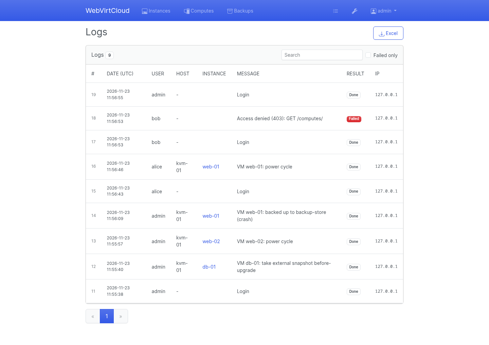

# WebVirtCloud
###### Python >=3.10 & Django 5.2 LTS (tested on Python 3.10 – 3.14)

WebVirtCloud is a **web visualization and management layer** for **libvirt**-based virtualization infrastructure.

From installation to a VM's first backup, in three and a half minutes:

https://github.com/user-attachments/assets/526fe16c-bfd7-46da-b986-689a37975e08

> **libvirt is the single source of truth.** WebVirtCloud reads, displays and triggers actions on libvirt state, but it is never the primary orchestrator.

- An administrator can connect to libvirt directly with **`virt-manager`** or **`virsh`** and create, delete, rename or reconfigure virtual machines. WebVirtCloud detects these changes and updates its database accordingly.
- Virtual machines keep running **even when WebVirtCloud is stopped**; the application only reflects the current state of libvirt.
- WebVirtCloud is not a full automation platform like Proxmox. Its goal is to expose libvirt's functionality through the browser in an accessible, role-based and secure way.

```
┌─────────────────────────────────────────────────────┐
│               Administrator / User                  │
└────────────┬───────────────────┬────────────────────┘
             │ Web browser        │ virt-manager / virsh
             ▼                   ▼
┌────────────────────┐  ┌─────────────────────────────┐
│   WebVirtCloud     │  │   libvirt API (direct)      │
│   (web UI layer)   │◄─┤   — separate, independent   │
└────────┬───────────┘  └──────────────┬──────────────┘
         │ libvirt API                  │
         ▼                             ▼
┌──────────────────────────────────────────────────────┐
│               libvirtd (hypervisor daemon)           │
│                    QEMU / KVM                        │
└──────────────────────────────────────────────────────┘
```

WebVirtCloud and `virt-manager`/`virsh` can manage the same libvirt host **concurrently and independently**. WebVirtCloud picks up external changes the next time the instance list page is loaded.

## Features

* QEMU/KVM hypervisor management (multiple compute nodes), with each host's capacity and what its VMs were given
* Host maintenance: a host in maintenance takes no new VMs, incoming migrations or VM starts; putting it in maintenance offers to migrate its VMs away with Bulk Migrate
* Balance: proposes migrations that even out the running VMs' memory, then vCPUs, as a share of each host's size
* Virtual machine lifecycle: create, delete, power management, clone (also of a running VM, with libvirt 11.10 or later), migrate (with or without shared storage), bulk migrate (a host's chosen VMs to another host, the chosen number at once), disk moves between pools
* Long operations (create, clone, delete, bulk power, snapshots, migration, disk moves, ISO upload, downloads from a URL, VM backups) run as jobs that the page follows; a queued job can be cancelled, and a running migration, ISO upload, download, backup or verification and the copy of a running VM (clone, disk move) too
* External snapshots (memory optional; without memory, guest file systems can be frozen through the agent)
* **External change detection:** VMs created, deleted or renamed via `virt-manager` or `virsh` are reconciled into the database automatically
* Real-time host statistics (CPU, RAM) and VM statistics (CPU, RAM, disk, network)
* A VM a fault stopped or paused says why (a disk error such as a full storage, a guest crash or kernel panic, its watchdog); its Settings tab chooses whether a guest that crashes, or hangs once it arms its watchdog, is restarted or stopped (new VMs get the panic device and watchdog this needs, older ones with the choice)
* Storage pool and volume management; a superuser downloads a volume from its pool page (not one a running VM uses), or makes one from a file at a URL
* Network (with DHCP leases), interface, network filter and secret management
* PCI and USB devices of the host given to VMs
* UEFI Secure Boot and TPM 2.0 for new VMs, as Windows 11 needs
* Browser-based VNC console (noVNC) and serial console
* Role-based access control: users see the VMs assigned to them, within their quota; an auditor permission shows every VM read-only
* 2FA (OTP / TOTP) and failed-login lockout
* SSH public key and root password management (guest agent for a running VM, gstfsd for a shut-off one)
* Finding VMs by IP or MAC address, and a VM report as an Excel file
* Tags on VMs and hosts, set by superusers: the lists filter by them, Bulk Migrate chooses VMs by them and a backup schedule backs up every VM with a chosen tag (templates left out)
* Protected VMs, set by superusers on the VM's Settings tab: not deleted and not restored over until the protection is turned off
* An audit log of who changed what, with its result
* Cloud-init datasource interface (OpenStack metadata compatible) and NoCloud seed media
* REST API — OpenAPI 3.0 (Swagger & ReDoc), with API tokens
* LDAP / Active Directory integration (optional)
* VM backups, of a running or shut-off VM, into a storage pool of your choice; a backup is restored as a new VM, over its own shut-off VM, or one disk as a new volume
* Daily backups of the panel, with an optional off-site copy (restic over SFTP)
* English, Turkish and Simplified Chinese

## Quick start

On a [supported Linux server](doc/install.md):

```bash
curl -fsSL -O https://raw.githubusercontent.com/retspen/webvirtcloud/master/install.sh
chmod 744 install.sh
sudo ./install.sh
```

Or with Docker, replacing the example names/IPs with those the panel is reached by:

```bash
git clone https://github.com/retspen/webvirtcloud
cd webvirtcloud
cat > docker-compose.override.yml <<'EOF'
services:
  webvirtcloud:
    environment:
      - ALLOWED_HOSTS=wvc.example.com,192.0.2.10
EOF
docker compose up -d
```

Then sign in at `http://<server-ip>` as `admin` ([first login](doc/install.md#first-login) shows where its password is) and [add a compute node](doc/compute-nodes.md).

## Documentation

| Topic | |
| --- | --- |
| [Installation](doc/install.md) | installer, Docker, manual installation, first login |
| [Adding a Compute Node](doc/compute-nodes.md) | KVM hosts over SSH, TCP, TLS or a local socket; gstfsd; migration |
| [Configuration](doc/configuration.md) | environment variables, local settings, HTTPS and reverse proxy, cloud-init, OTP, alerts, serial console |
| [LDAP](doc/ldap.md) | LDAP / Active Directory login |
| [Backups](doc/backups.md) | daily panel backups, off-site copy, VM backups |
| [Updating](doc/upgrading.md) | update, restore and rollback, moving to a new machine, behavior changes |
| [Users, Roles and Permissions](doc/permissions.md) | superusers, staff, VM owners, auditors |
| [REST API](doc/api.md) | Swagger, ReDoc, API tokens |
| [Architecture](doc/architecture.md) | how the panel is built |
| [Development](CONTRIBUTING.md) | dev setup, translations, tests |

## Screenshots

| VM list | VM page |
|:---:|:---:|
|  |  |

| Computes | Host overview |
|:---:|:---:|
|  |  |

| New VM | Logs |
|:---:|:---:|
|  |  |

## License

WebVirtCloud is licensed under the [Apache Licence, Version 2.0](http://www.apache.org/licenses/LICENSE-2.0.html).
