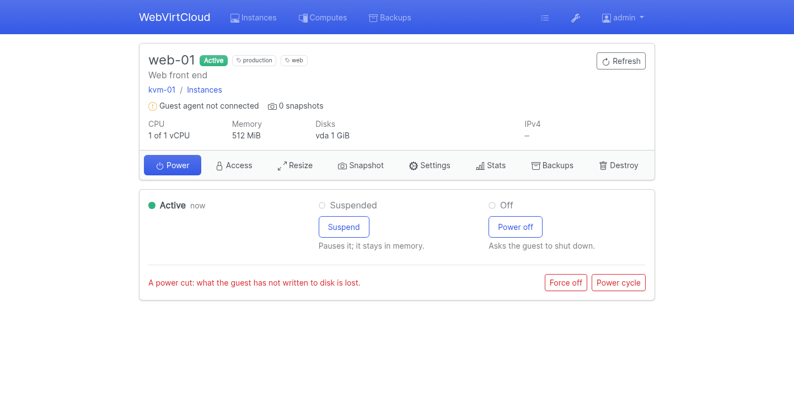
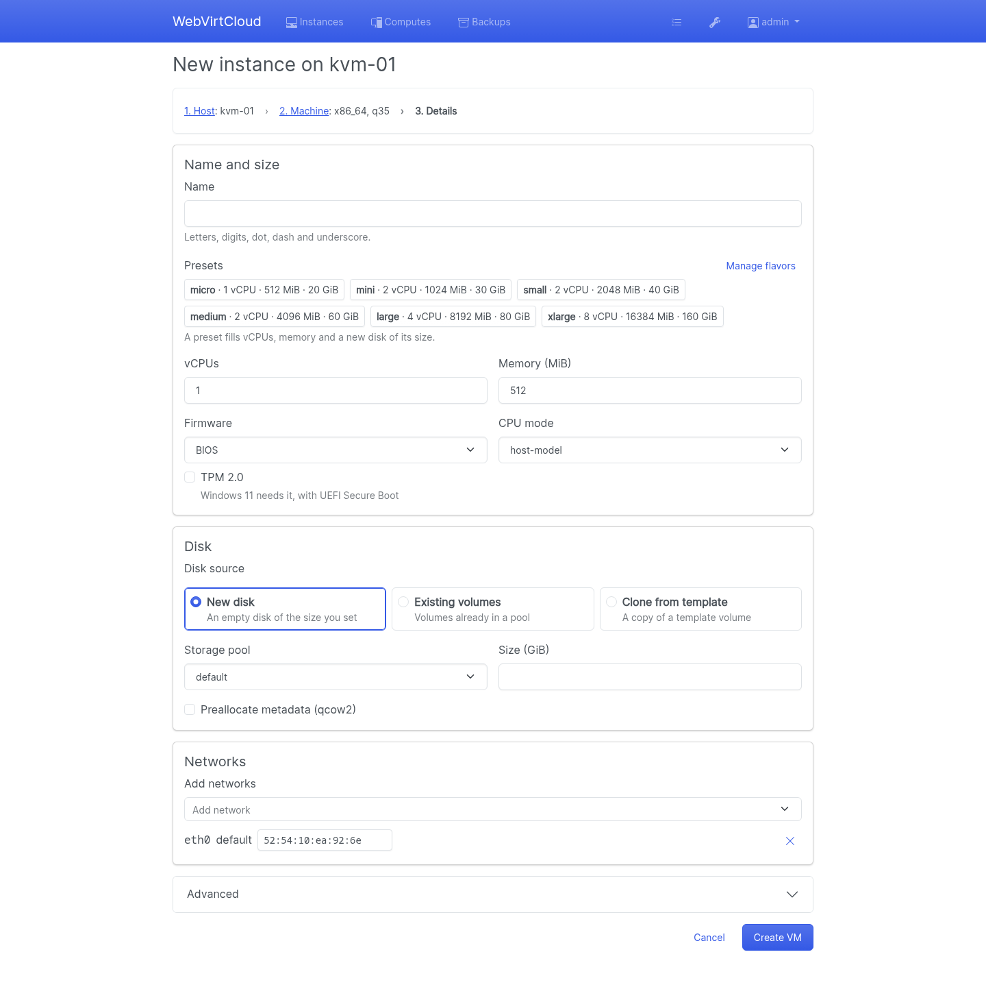

# WebVirtCloud
###### Python >=3.10 & Django 5.2 LTS (tested on Python 3.10 – 3.14)

WebVirtCloud is a **web visualization and management layer** for **libvirt**-based virtualization infrastructure.

From installation to a VM's first backup, in three and a half minutes:

https://github.com/user-attachments/assets/526fe16c-bfd7-46da-b986-689a37975e08

> **libvirt is the single source of truth.** WebVirtCloud reads, displays and triggers actions on libvirt state, but it is never the primary orchestrator.

- An administrator can connect to libvirt directly with **`virt-manager`** or **`virsh`** and create, delete, rename or reconfigure virtual machines. WebVirtCloud detects these changes and updates its database accordingly.
- Virtual machines keep running **even when WebVirtCloud is stopped**; the application only reflects the current state of libvirt.
- WebVirtCloud is not a full automation platform like Proxmox. Its goal is to expose libvirt's functionality through the browser in an accessible, role-based and secure way.

```
┌─────────────────────────────────────────────────────┐
│               Administrator / User                  │
└────────────┬───────────────────┬────────────────────┘
             │ Web browser        │ virt-manager / virsh
             ▼                   ▼
┌────────────────────┐  ┌─────────────────────────────┐
│   WebVirtCloud     │  │   libvirt API (direct)      │
│   (web UI layer)   │◄─┤   — separate, independent   │
└────────┬───────────┘  └──────────────┬──────────────┘
         │ libvirt API                  │
         ▼                             ▼
┌──────────────────────────────────────────────────────┐
│               libvirtd (hypervisor daemon)           │
│                    QEMU / KVM                        │
└──────────────────────────────────────────────────────┘
```

WebVirtCloud and `virt-manager`/`virsh` can manage the same libvirt host **concurrently and independently**. WebVirtCloud picks up external changes the next time the instance list page is loaded.

## Features

* Several QEMU/KVM hosts, with their capacity, a maintenance mode and proposed migrations that balance them
* VMs: create, power, clone (also running), migrate (with or without shared storage, many at once), delete
* Long operations run as jobs that the page follows and that can be cancelled
* External snapshots and disk moves between pools
* VM backups into a storage pool, by hand or on a schedule, verified, restored as a new VM or over the VM
* Daily backups of the panel itself, with an optional off-site copy
* VMs created, renamed or deleted with `virsh` or `virt-manager` are picked up on their own
* Live host and VM statistics, and the reason a VM stopped or paused on a fault
* Storage pools and volumes, networks, interfaces, network filters and secrets
* PCI and USB devices given to VMs; UEFI Secure Boot and TPM 2.0 for Windows 11
* VNC (noVNC) and serial consoles in the browser
* Users see only their VMs, within quotas; an auditor permission sees every VM read-only; two-factor login and login lockout
* SSH keys and root passwords set in guests
* Tags, protected VMs, search by IP or MAC address and a VM report as an Excel file
* An audit log of who changed what
* Alerts by e-mail or webhook, and a health check URL
* Cloud-init metadata (OpenStack compatible) and NoCloud seed disks
* REST API (OpenAPI 3.0) with API tokens
* LDAP / Active Directory login (optional)
* English, Turkish and Simplified Chinese

## Quick start

On a [supported Linux server](doc/install.md):

```bash
curl -fsSL -O https://raw.githubusercontent.com/retspen/webvirtcloud/master/install.sh
chmod 744 install.sh
sudo ./install.sh
```

Or with Docker, replacing the example names/IPs with those the panel is reached by:

```bash
git clone https://github.com/retspen/webvirtcloud
cd webvirtcloud
cat > docker-compose.override.yml <<'EOF'
services:
  webvirtcloud:
    environment:
      - ALLOWED_HOSTS=wvc.example.com,192.0.2.10
EOF
docker compose up -d
```

Then sign in at `http://<server-ip>` as `admin` ([first login](doc/install.md#first-login) shows where its password is) and [add a compute node](doc/compute-nodes.md).

## Documentation

| Topic | |
| --- | --- |
| [Installation](doc/install.md) | installer, Docker, manual installation, first login |
| [Adding a Compute Node](doc/compute-nodes.md) | KVM hosts over SSH, TCP, TLS or a local socket; gstfsd; migration |
| [Configuration](doc/configuration.md) | environment variables, local settings, HTTPS and reverse proxy, cloud-init, OTP, alerts, serial console |
| [LDAP](doc/ldap.md) | LDAP / Active Directory login |
| [Backups](doc/backups.md) | daily panel backups, off-site copy, VM backups |
| [Updating](doc/upgrading.md) | update, restore and rollback, moving to a new machine, behavior changes |
| [Users, Roles and Permissions](doc/permissions.md) | superusers, staff, VM owners, auditors |
| [REST API](doc/api.md) | Swagger, ReDoc, API tokens |
| [Architecture](doc/architecture.md) | how the panel is built |
| [Development](CONTRIBUTING.md) | dev setup, translations, tests |

## Screenshots

| VM list | VM page |
|:---:|:---:|
|  |  |

| Computes | Host overview |
|:---:|:---:|
|  |  |

| New VM | Logs |
|:---:|:---:|
|  |  |

## License

WebVirtCloud is licensed under the [Apache Licence, Version 2.0](http://www.apache.org/licenses/LICENSE-2.0.html).
