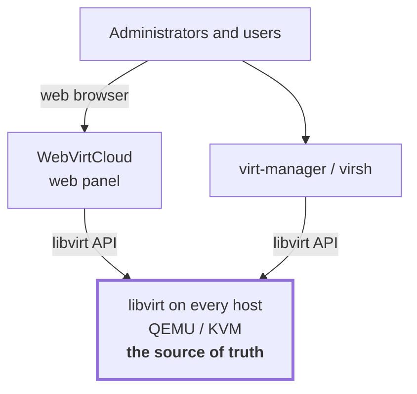

<div align="center">

# WebVirtCloud

**Manage libvirt and KVM hosts from the browser, with users, roles and quotas.**

[](https://github.com/retspen/webvirtcloud/actions/workflows/test.yml)
[](https://github.com/retspen/webvirtcloud/actions/workflows/installer.yml)


[](http://www.apache.org/licenses/LICENSE-2.0.html)

[Quick start](#quick-start) | [Documentation](#documentation) | [Screenshots](#screenshots) | [REST API](doc/api.md)

</div>

From installation to a VM's first backup, in three and a half minutes:

https://github.com/user-attachments/assets/526fe16c-bfd7-46da-b986-689a37975e08

> **libvirt is the single source of truth.** WebVirtCloud reads, displays and triggers actions on libvirt state, but it is never the primary orchestrator.



- An administrator can connect to libvirt directly with **`virt-manager`** or **`virsh`** and create, delete, rename or reconfigure virtual machines. WebVirtCloud picks these changes up the next time the VM list is loaded.
- Virtual machines keep running **even when WebVirtCloud is stopped**; the application only reflects the current state of libvirt.
- WebVirtCloud is not a full automation platform like Proxmox. Its goal is to expose libvirt's functionality through the browser in an accessible, role-based and secure way.

## Features

<table>
<tr>
<td valign="top" width="50%">
<h3>Hosts</h3>
<ul>
<li>Several QEMU/KVM hosts, with their capacity, a maintenance mode and proposed migrations that balance them</li>
<li>Storage pools and volumes, networks, interfaces, network filters and secrets</li>
<li>PCI and USB devices given to VMs</li>
<li>Live host statistics</li>
</ul>
</td>
<td valign="top" width="50%">
<h3>Virtual machines</h3>
<ul>
<li>Create, power, clone (also running), migrate (with or without shared storage, many at once), delete</li>
<li>External snapshots and disk moves between pools</li>
<li>VNC (noVNC) and serial consoles in the browser</li>
<li>UEFI Secure Boot and TPM 2.0 for Windows 11</li>
<li>Live VM statistics, and the reason a VM stopped or paused on a fault</li>
<li>SSH keys and root passwords set in guests; cloud-init metadata (OpenStack compatible) and NoCloud seed disks</li>
</ul>
</td>
</tr>
<tr>
<td valign="top" width="50%">
<h3>Users and access</h3>
<ul>
<li>Users see only their VMs, within quotas; an auditor permission sees every VM read-only</li>
<li>Two-factor login and login lockout; LDAP / Active Directory login (optional)</li>
<li>An audit log of who changed what</li>
<li>REST API (OpenAPI 3.0) with API tokens</li>
</ul>
</td>
<td valign="top" width="50%">
<h3>Operations</h3>
<ul>
<li>Long operations run as jobs that the page follows and that can be cancelled</li>
<li>VM backups into a storage pool, by hand or on a schedule, verified, restored as a new VM or over the VM</li>
<li>Daily backups of the panel itself, with an optional off-site copy</li>
<li>VMs created, renamed or deleted with <code>virsh</code> or <code>virt-manager</code> are picked up on their own</li>
<li>Tags, protected VMs, search by IP or MAC address and a VM report as an Excel file</li>
<li>Alerts by e-mail or webhook, and a health check URL</li>
<li>English, Turkish and Simplified Chinese</li>
</ul>
</td>
</tr>
</table>

## Quick start

On a [supported Linux server](doc/install.md):

```bash
curl -fsSL -O https://raw.githubusercontent.com/retspen/webvirtcloud/master/install.sh
chmod 744 install.sh
sudo ./install.sh
```

Or with Docker, replacing the example names/IPs with those the panel is reached by:

```bash
git clone https://github.com/retspen/webvirtcloud
cd webvirtcloud
cat > docker-compose.override.yml <<'EOF'
services:
  webvirtcloud:
    environment:
      - ALLOWED_HOSTS=wvc.example.com,192.0.2.10
EOF
docker compose up -d
```

Then sign in at `http://<server-ip>` as `admin` ([first login](doc/install.md#first-login) shows where its password is) and [add a compute node](doc/compute-nodes.md).

## Documentation

| Topic | |
| --- | --- |
| [Installation](doc/install.md) | installer, Docker, manual installation, first login |
| [Adding a Compute Node](doc/compute-nodes.md) | KVM hosts over SSH, TCP, TLS or a local socket; gstfsd; migration |
| [Configuration](doc/configuration.md) | environment variables, local settings, HTTPS and reverse proxy, cloud-init, OTP, alerts, serial console |
| [LDAP](doc/ldap.md) | LDAP / Active Directory login |
| [Backups](doc/backups.md) | daily panel backups, off-site copy, VM backups |
| [Updating](doc/upgrading.md) | update, restore and rollback, moving to a new machine, behavior changes |
| [Users, Roles and Permissions](doc/permissions.md) | superusers, staff, VM owners, auditors |
| [REST API](doc/api.md) | Swagger, ReDoc, API tokens |
| [Architecture](doc/architecture.md) | how the panel is built |
| [Development](CONTRIBUTING.md) | dev setup, translations, tests |

## Screenshots

| VM list | VM page |
|:---:|:---:|
|  |  |

| Computes | Host overview |
|:---:|:---:|
|  |  |

| New VM | Logs |
|:---:|:---:|
|  |  |

## License

WebVirtCloud is licensed under the [Apache Licence, Version 2.0](http://www.apache.org/licenses/LICENSE-2.0.html).
